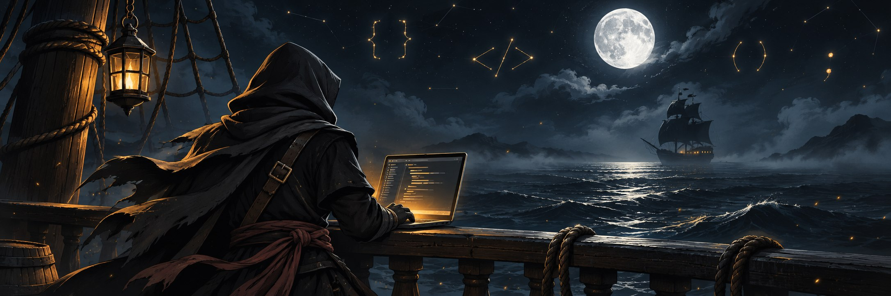

  

  # BONITAAA

  ### `True pirates, follow — or jump.`

  

    Développeur JavaScript · Créateur de bots Discord · Navigue en eaux privées
  

  

    
    
  

---

## 🏴‍☠️ À bord

Je construis des bots et des outils en **JavaScript**, quelque part entre une idée, quelques commandes et beaucoup trop de commits.

- ⚓ Basé à **Yamanaka**
- 🧭 Actuellement sur des projets privés
- 💬 Principalement actif autour de **Discord**
- 🌊 Toujours en train d'apprendre, tester et améliorer

## ⚙️ Arsenal

  

## 📊 Journal de bord

  
  

  ⚔️ Le code est peut-être privé, mais les contributions parlent d'elles-mêmes.

